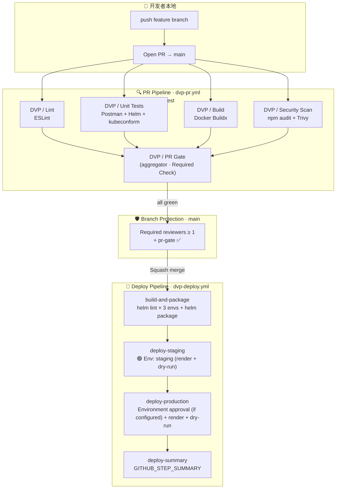

# DevOps Platform Demo | DevOps / SRE

一个面向 DevOps / SRE 工程实践的可复现演示项目，覆盖 PR 质量门禁、制品打包、部署前校验、本地 Kubernetes、IaC、GitOps、DevSecOps 与可观测性配置。项目使用外部示例 API 和 LocalStack，不是生产业务系统。

## What This Project Demonstrates

```
PR → lint / manifest & chart validation / Docker image build / security checks
  → PR Gate
Merge to main → Helm package + SBOM → render manifests + dry-run → smoke test
Local demo → k3d / Kubernetes + ArgoCD configuration + Prometheus / Grafana
```

**Deployment boundary:** GitHub Actions packages the Helm chart, renders manifests, and runs a deployment dry-run; it does not deploy to a live cluster. ArgoCD and Kubernetes resources are available for a separately configured local demo.

### Implemented Capabilities

| Component | Technology | What It Does |
|-----------|-----------|--------------|
| **PR quality gate** | GitHub Actions | ESLint, manifest/chart validation, Docker image build, npm audit, Trivy, and test-count gates |
| **Release validation** | GitHub Actions + Helm | Helm package and SBOM artifacts, rendered manifests, dry-run stages; production approval can be enforced through GitHub Environment reviewer settings |
| **Automated tests** | Cypress + Newman | Browser E2E and API contract checks against public example APIs |
| **Infrastructure as Code** | Terraform + LocalStack | AWS resource configuration for local emulation; environment-specific variable files |
| **Container orchestration** | Kubernetes (k3d) | Deployments, Jobs, Services, Ingress, PVCs, and ConfigMaps |
| **GitOps configuration** | ArgoCD | Application manifests for auto-sync and manual-sync examples |
| **Security checks** | Trivy + npm audit | PR dependency and filesystem checks; separate Terraform validation workflow |
| **Observability configuration** | Prometheus + Grafana | Metrics scripts, alert rules, and dashboard JSON files |

### Follow-up Work

| Component | Technology | What It Adds |
|-----------|-----------|-------------|
| **Real cluster delivery** | ArgoCD or a secured runner | Replace workflow dry-runs with deployment to a reachable, credentialed cluster |
| **Pipeline telemetry integration** | Pushgateway + Prometheus | Configure a reachable Pushgateway and validate metrics ingestion end to end |
| **Centralized log aggregation** | Loki + Promtail | Collect cluster and workload logs in Grafana |
| **Alert routing** | AlertManager | Configure and verify a notification receiver for actionable alerts |

See [WBS.md](docs/project-management/WBS.md) for detailed task breakdown.

## Quick Start

### Dev Container（推荐）

容器内工具版本固定并与 CI 对齐，复用宿主机 k3d 集群，不额外启动 Kubernetes 集群。

| 项目 | 说明 |
|------|------|
| 打开方式 | 在 VS Code 中打开 `devops-platform-demo/`，执行 “Dev Containers: Reopen in Container” |
| 工具链 | Node 20.20.0、Terraform 1.7.5、Helm 3.14.0、kubectl 1.33.6、k3d 5.8.3、Trivy 0.70.0、Kyverno 1.20.0、Azure CLI 2.84.0 |
| 资源限制 | `--memory=2g --cpus=2` |
| 集群访问 | 通过 `host.docker.internal` 访问宿主 k3d，并使用 `tls-server-name: localhost` 校验 TLS |
| Cypress | 不在容器内运行；使用 `npm run docker:test` |

```bash
.devcontainer/verify-tools.sh
.devcontainer/verify-tools.sh --drift
k3d cluster stop portfolio-dev  # 暂停演示时释放资源
```

请从主 clone 打开项目，不要从 git worktree 启动；Dev Container 会将仓库根目录挂载至容器。所有 checkout 共用 `dvp-node-modules` 命名 volume。本机使用代理时，Docker 代理地址须在容器内可达（例如 `host.docker.internal`）。

### Run Tests Locally

```bash
cd devops-platform-demo
npm ci
npm run lint
npm test                         # Cypress + Newman; requires network access
npm run test:cypress:headed      # Interactive Cypress
```

### Run in Docker

```bash
npm run docker:test              # Docker containers
npm run docker:test:logs         # With detailed logs
```

### Optional Local Kubernetes Demo

```bash
# Prerequisites: docker, kubectl, k3d, terraform, helm
# Create cluster
k3d cluster create qa-portfolio --agents 2 --port "8080:80@loadbalancer"

# Start LocalStack for the Terraform demo
docker compose -f docker-compose.localstack.yml up -d

# Deploy infrastructure
cd terraform && terraform init -backend=false && terraform apply -var-file=environments/dev.tfvars

# Deploy to K8s
cd ../k8s && ./deploy-to-k8s.sh

# Install ArgoCD
cd ../gitops/argocd && ./install-argocd.sh

# Install monitoring
cd ../../monitoring && ./deploy-monitoring.sh
```

### Access Dashboards

```bash
# Grafana (after installing the optional local monitoring components)
kubectl port-forward -n monitoring svc/prometheus-grafana 3000:80
# Open http://localhost:3000 (admin / grafana-admin)

# ArgoCD (GitOps deployments)
kubectl port-forward -n argocd svc/argocd-server 9090:443
# Open https://localhost:9090

# Prometheus (raw metrics)
kubectl port-forward -n monitoring svc/prometheus-kube-prometheus-prometheus 9091:9090
```

## Project Structure

```
devops-platform-demo/
├── .github/
│   └── WORKFLOWS-GUIDE.md          # Workflows 说明（实际 workflows 在仓库根 .github/workflows/）
│
├── cypress/                         # Cypress E2E 测试
│   ├── e2e/
│   │   ├── 01-api-tests.cy.js      #   API 端点验证
│   │   └── 02-ui-tests.cy.js       #   UI 功能验证
│   └── support/                     #   Cypress 支持文件
│
├── postman/                         # Newman API 测试
│   ├── api-collection.json          #   Postman 集合 (18 assertions)
│   └── environment.json             #   环境变量配置
│
├── terraform/                       # Infrastructure as Code
│   ├── main.tf                      #   S3 buckets, DynamoDB table
│   ├── variables.tf                 #   可配置参数
│   ├── outputs.tf                   #   输出定义
│   ├── provider.tf                  #   Provider 配置 (Localstack)
│   ├── backend.tf                   #   S3 远程状态后端
│   ├── modules/                     #   可复用 Terraform 模块
│   └── environments/                #   多环境 tfvars
│       ├── dev.tfvars               #     开发环境
│       ├── staging.tfvars           #     预生产环境
│       └── production.tfvars        #     生产环境
│
├── k8s/                             # Kubernetes 清单文件
│   ├── namespace.yaml               #   qa-portfolio 命名空间
│   ├── deployment.yaml              #   测试结果服务器 (nginx)
│   ├── service.yaml                 #   ClusterIP Service
│   ├── ingress.yaml                 #   外部访问入口
│   ├── configmap.yaml               #   配置数据
│   ├── pvc.yaml                     #   持久化存储 (5Gi)
│   ├── job-cypress.yaml             #   Cypress 测试 Job
│   ├── job-newman.yaml              #   Newman 测试 Job
│   ├── deploy-to-k8s.sh            #   一键部署脚本
│   └── README.md                    #   K8S 部署说明
│
├── helm/qa-portfolio/               # Helm Chart
│   ├── Chart.yaml                   #   Chart 元数据
│   ├── values.yaml                  #   默认值
│   ├── values-staging.yaml          #   Staging 覆盖值
│   ├── values-production.yaml       #   Production 覆盖值
│   └── templates/                   #   K8S 模板
│       ├── deployment.yaml          #     Deployment 模板
│       ├── service.yaml             #     Service 模板
│       ├── ingress.yaml             #     Ingress 模板
│       ├── configmap.yaml           #     ConfigMap 模板
│       ├── namespace.yaml           #     Namespace 模板
│       ├── pvc.yaml                 #     PVC 模板
│       ├── job-cypress.yaml         #     Cypress Job 模板
│       ├── job-newman.yaml          #     Newman Job 模板
│       ├── _helpers.tpl             #     模板助手函数
│       └── NOTES.txt                #     安装后提示
│
├── gitops/argocd/                   # GitOps 配置
│   ├── install-argocd.sh            #   ArgoCD 安装脚本
│   ├── project.yaml                 #   AppProject (RBAC)
│   └── applications/                #   应用定义
│       ├── qa-portfolio-dev.yaml    #     Dev 环境 (auto-sync)
│       └── qa-portfolio-staging.yaml#     Staging 环境 (manual sync)
│
├── monitoring/                      # 可观测性堆栈
│   ├── prometheus-values.yaml       #   Prometheus + Grafana Helm values
│   ├── deploy-monitoring.sh         #   自动化部署脚本
│   ├── verify-monitoring.sh         #   健康检查脚本
│   ├── MONITORING.md                #   监控架构文档
│   ├── dashboards/                  #   Grafana 仪表盘
│   │   ├── cluster-overview.json    #     集群概览 (14 panels)
│   │   └── test-metrics.json        #     测试指标仪表盘
│   ├── grafana/                     #   Grafana 配置
│   └── prometheus/                  #   Prometheus 配置
│
├── security/                        # 安全扫描配置
│   ├── trivy-config.yaml            #   扫描规则、严重度阈值
│   ├── security-report.sh           #   综合报告生成器
│   └── README.md                    #   安全扫描说明
│
├── scripts/                         # 自动化脚本
│   ├── validate-environment.sh      #   环境预检
│   ├── fix-permissions.sh           #   Docker 文件权限修复
│   ├── deploy-helm.sh              #   Helm 部署脚本
│   ├── generate-dashboard.sh        #   仪表盘生成
│   ├── run-regression-test-with-logs.sh  # 回归测试（带日志）
│   ├── track-test-execution.sh      #   测试执行追踪
│   ├── track-test-execution-simple.sh   # 简化版执行追踪
│   └── test-logs/                   #   测试日志输出
│
├── docs/                            # 文档
│   ├── README.md                    #   文档索引
│   ├── architecture/
│   │   └── ARCHITECTURE.md          #     技术架构深度解析
│   ├── guides/
│   │   ├── QUICKSTART.md            #     5 分钟快速上手
│   │   ├── FAQ-GUIDE.md             #     35+ 常见问题解答
│   │   ├── CI-CD-GUIDE.md           #     CI/CD 管道指南
│   │   ├── TROUBLESHOOTING.md       #     故障排查手册
│   │   └── GITHUB-ACTIONS-VERIFICATION.md  # GitHub Actions 验证
│   ├── project-management/
│   │   ├── WBS.md                   #     工作分解结构
│   │   ├── CICD-COMPLETE-ANALYSIS.md#     CI/CD 完整分析
│   │   └── REGRESSION-TEST-RESULT.md#     回归测试结果
│   ├── fixes/                       #   Bug 修复记录
│   │   ├── BUG-LIST.md              #     Bug 清单
│   │   ├── BUGFIX-SUMMARY.md        #     修复摘要
│   │   └── BUG-FIX-LOG-2026-02-21.md#    修复日志
│   ├── diagrams/                    #   架构图（预留）
│   ├── AZURE-VS-GITHUB-ACTIONS.md   #   跨平台 CI/CD 对比
│   ├── VERIFICATION-GUIDE.md        #   验证指南
│   └── PHASE-*.md                   #   各阶段完成报告
│
├── docker-compose.yml               # 容器编排（测试环境）
├── docker-compose.localstack.yml    # Localstack 本地 AWS 模拟
├── Dockerfile.newman                # Newman 容器镜像
├── cypress.config.js                # Cypress 配置
├── package.json                     # NPM 依赖 & 脚本
├── azure-pipelines.yml              # Azure Pipelines 配置参考
├── verify-all-phases.sh             # 全阶段验证脚本
├── create-test-pr.sh                # 测试 PR 创建脚本
├── CLAUDE.md                        # Claude 项目指南
└── SECURITY.md                      # 安全策略
```

## Security Checks

| Workflow | Check | Gate |
|----------|-------|------|
| `dvp-pr.yml` | `npm audit --omit=dev` | Fail on moderate or higher dependency findings |
| `dvp-pr.yml` | Trivy filesystem scan | Fail on HIGH or CRITICAL findings |
| `dvp-terraform.yml` | Terraform format and validation, Trivy IaC scan | Fail on format/validation errors or HIGH/CRITICAL findings |

These workflows do not currently upload SARIF reports or scan the built container image with Trivy.

### Suppressing Known / Accepted Risks

Add entries to `devops-platform-demo/.trivyignore`:

```
# Format: CVE-ID  # reason | expires: YYYY-MM-DD
CVE-2024-12345  # false positive - not exploitable in our context | expires: 2025-06-01
```


### Current: PR Gate and Deployment Dry-Run

```
Pull request ──→ DVP PR workflow ──→ lint + config validation + image build + security / quality gates
Merge to main ──→ DVP deploy workflow ──→ Helm + SBOM artifacts ──→ manifest render + dry-run ──→ smoke test
Pull request ──→ DVP Terraform workflow ──→ fmt + validate + IaC scan
```

The deploy workflow hands off build artifacts and validates the release path, but does not apply manifests to a live cluster. The PR workflow also attempts to push pipeline metrics; successful ingestion requires a reachable Pushgateway.

### Follow-up: Operational Integration

```
Rendered manifests + reviewed artifact ──→ secured cluster deployment
Pipeline metrics ──→ reachable Pushgateway ──→ Prometheus ──→ Grafana
Pod logs ──→ Promtail ──→ Loki ──→ Grafana log explorer
Actionable alerts ──→ AlertManager ──→ configured receiver
```

## Infrastructure Overview

### Kubernetes Cluster (k3d)

```
Nodes: 3 (1 server + 2 agents)
Namespaces: qa-portfolio, argocd, monitoring, kube-system
Total Pods: 30+
```

### Namespace Breakdown

| Namespace | Pods | Purpose |
|-----------|------|---------|
| qa-portfolio | 1 | Test results server (nginx) |
| argocd | 7 | GitOps controller, repo server, UI |
| monitoring | 8 | Prometheus, Grafana, AlertManager, Node Exporter |
| kube-system | 9 | CoreDNS, Traefik, Metrics Server |

## GitHub Actions Workflows

| Workflow | Trigger | Purpose |
|----------|---------|---------|
| `dvp-pr.yml` | PR to main (`devops-platform-demo/**`), manual | Lint, Helm/Kubernetes validation, Docker image build, npm audit, Trivy filesystem scan, quality gate, PR gate |
| `dvp-deploy.yml` | Push to main (`devops-platform-demo/**`), manual | Helm package + SBOM, staging manifest render/dry-run + external API smoke test, Environment-controlled production render/dry-run (reviewer approval depends on settings) |
| `dvp-terraform.yml` | Terraform changes in PR, manual | Terraform format, validation, and IaC security checks |
| `ci.yml` | PR to main | Android and EDI project unit tests |

### PR → Merge → Deploy 流程

```
┌───────────────────────────────────────────────────────────────────────┐
│  Developer pushes feature branch → opens PR to main                   │
└───────────────────────────────────────────────────────────────────────┘
                                  │
                                  ▼
┌───────────────────────────────────────────────────────────────────────┐
│  dvp-pr.yml (on: pull_request)                                                   │
│                                                                       │
│   ┌────────┐  ┌────────────┐  ┌───────┐  ┌──────────────┐             │
│   │  lint  │  │ unit-tests │  │ build │  │ security-scan│  (parallel) │
│   └───┬────┘  └─────┬──────┘  └───┬───┘  └──────┬───────┘             │
│       └─────────────┴─────────────┴─────────────┘                     │
│                          │                                            │
│                          ▼                                            │
│                  ┌───────────────┐                                    │
│                  │   pr-gate     │ ◄── Branch Protection 唯一 Required│
│                  │ (aggregator)  │     Check                          │
│                  └───────┬───────┘                                    │
└──────────────────────────┼────────────────────────────────────────────┘
                           │ ✅ all green
                           ▼
                  ┌────────────────┐
                  │  Squash merge  │
                  │   into main    │
                  └───────┬────────┘
                          │
                          ▼
┌───────────────────────────────────────────────────────────────────────┐
│  dvp-deploy.yml (on: push to main)                                               │
│                                                                       │
│   ┌──────────────────┐                                                │
│   │ build-and-package│  (helm lint × 3 envs, helm package)            │
│   └────────┬─────────┘                                                │
│            ▼                                                          │
│   ┌──────────────────┐                                                │
│   │  deploy-staging  │  staging manifests (render + dry-run)          │
│   └────────┬─────────┘                                                │
│            ▼                                                          │
│   ┌──────────────────┐                                                │
│   │ smoke-test-staging│  External example API checks                  │
│   └────────┬─────────┘                                                │
│            ▼                                                          │
│   ┌──────────────────┐                                                │
│   │ deploy-production│  Approval-gated manifest render + dry-run      │
│   └────────┬─────────┘                                                │
│            ▼                                                          │
│   ┌──────────────────┐                                                │
│   │  deploy-summary  │  (写入 GITHUB_STEP_SUMMARY)                    │
│   └──────────────────┘                                                │
└───────────────────────────────────────────────────────────────────────┘
```

#### PR → Merge → Deploy 端到端流程图（Mermaid）



### Branch Protection 配置（Settings → Branches → `main`）

为保证 PR 必须通过 PR Pipeline 才能合并，需在仓库设置中启用以下规则：

**配置路径**：`GitHub Repo → Settings → Branches → Branch protection rules → Add rule`

| 设置 | 取值 |
|------|------|
| Branch name pattern | `main` |
| Require a pull request before merging | ✅ 开启 |
| Require approvals | ≥ 1 |
| Dismiss stale pull request approvals when new commits are pushed | ✅ 开启 |
| Require status checks to pass before merging | ✅ 开启 |
| Require branches to be up to date before merging | ✅ 开启 |
| Require conversation resolution before merging | ✅ 开启 |
| Do not allow bypassing the above settings | ✅ 开启 |

**必需 Status Check**（与 `dvp-pr.yml` 中 job 一致）：

| Status Check 名称 | 来源 Job | 是否必需 |
|-------------------|----------|----------|
| `DVP / PR Gate` | `pr-gate` (aggregator) | ✅ **唯一必需** |
| `DVP / Lint` | `lint` | ⚪ 可选（已被 PR Gate 聚合） |
| `DVP / Unit Tests` | `unit-tests` | ⚪ 可选（已被 PR Gate 聚合） |
| `DVP / Build` | `build` | ⚪ 可选（已被 PR Gate 聚合） |
| `DVP / Security Scan` | `security-scan` | ⚪ 可选（已被 PR Gate 聚合） |

> 💡 **设计取舍**：`pr-gate` 汇总 lint、配置测试、镜像构建、安全扫描和质量门禁；任何一项未成功则 gate 失败。**只配置 `DVP / PR Gate` 一项必需 check 即可**，避免新增或重命名子 job 时需要同步更新 branch protection。
>
> 如希望在 PR UI 中并排显示各子 job 状态以便排错，可将其他 4 项也加入必需 checks 列表（功能等价，仅 UI 表达不同）。
>
> ⚠️ **注意 `pr-gate` 与 `defaults.run.working-directory`**：PR workflow 的 `pr-gate` 不执行 checkout，因此显式将工作目录覆盖为 `.`，避免继承 workflow 默认目录后启动失败。

**本地验证 Checklist**（提 PR 前确认）：

- [ ] `cd devops-platform-demo && npm ci` 安装依赖成功
- [ ] `npm run lint`（ESLint）无错误
- [ ] `npm test`（如适用）通过
- [ ] `helm lint helm/qa-portfolio --values helm/qa-portfolio/values-dev.yaml` 通过
- [ ] `helm template ... | kubeconform -strict -summary -` 通过
- [ ] `docker build -f Dockerfile.newman -t devops-platform-demo:pr-check .` 成功
- [ ] `npm audit --omit=dev --audit-level=moderate` 无 ≥ moderate 漏洞
- [ ] `trivy fs --severity HIGH,CRITICAL --exit-code 1 .` 无 HIGH/CRITICAL 漏洞
- [ ] commit subject ≤ 72 字符（避免 PDEF-003 / Commit Guard 红灯）

### GitHub Environments 配置（Settings → Environments）

部署流水线使用 GitHub Environments 控制 staging / production 的访问与审批：

| Environment | 配置建议 |
|-------------|----------|
| `staging` | 自动部署；可选 secrets：`STAGING_KUBECONFIG` |
| `production` | Required reviewers ≥ 1（手动审批）；wait timer 可选；secrets：`PROD_KUBECONFIG` |

> 在 GitHub-hosted runner 上 deploy job 默认执行 dry-run（`helm template` 渲染产物作为 artifact 上传）。Production 审批需在 GitHub Environment 中配置 Required reviewers；如需真实集群部署，还需在安全评估后配置受限的部署凭据和目标集群。

## Documentation

| Document | What It Covers |
|----------|---------------|
| [ARCHITECTURE.md](docs/architecture/ARCHITECTURE.md) | 技术架构、设计决策、扩展性 |
| [WBS.md](docs/project-management/WBS.md) | 项目工作分解与后续事项 |
| [QUICKSTART.md](docs/guides/QUICKSTART.md) | 本地测试与可选集群演示 |
| [FAQ-GUIDE.md](docs/guides/FAQ-GUIDE.md) | 35+ Q&A，覆盖 6 个技术领域 |
| [CI-CD-GUIDE.md](docs/guides/CI-CD-GUIDE.md) | CI/CD 管道搭建与集成 |
| [TROUBLESHOOTING.md](docs/guides/TROUBLESHOOTING.md) | 故障排查手册 |
| Azure vs GitHub Actions | 跨平台 CI/CD 对比 FAQ |
| [MONITORING.md](monitoring/MONITORING.md) | 监控架构与仪表盘配置 |

## FAQ

### 30-Second Pitch

> "I built a DevOps/SRE portfolio project that validates pull requests with lint, Kubernetes and Helm checks, container builds, and security gates. The release workflow packages a Helm chart and SBOM, renders environment-specific manifests, and demonstrates dry-run stages with optional Environment-based approval. I also provide local Kubernetes, Terraform/LocalStack, ArgoCD, Prometheus, and Grafana configurations, while clearly separating those demos from production deployment."

### Key Skills Demonstrated

- **Terraform IaC**: Multi-environment (dev/staging/prod) with Localstack
- **Kubernetes**: Deployments, Jobs, Services, Ingress, PVCs, ConfigMaps, 3-node k3d
- **GitOps**: ArgoCD application configuration with auto-sync and manual-sync examples
- **Security Scanning**: PR npm audit and Trivy filesystem checks, plus Terraform IaC checks
- **Monitoring**: Prometheus configuration, Grafana dashboards, and alert rules
- **CI/CD Pipeline Design**: PR quality gates, Helm/SBOM artifact generation, and deployment dry-runs
- **Docker**: Multi-container orchestration, custom images, volume caching

### Pre-Demo Checklist

```bash
cd devops-platform-demo
npm ci
npm run lint
npm test
```

See [FAQ-GUIDE.md](docs/guides/FAQ-GUIDE.md) for 35+ Q&A with detailed answers.
