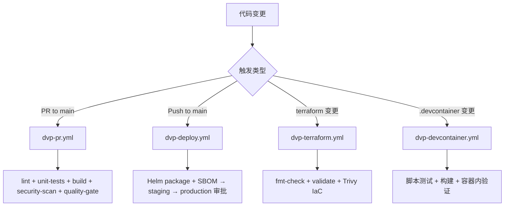

# CI/CD Guide

## 当前有效 workflow

| Workflow | Trigger | Purpose |
|----------|---------|---------|
| `dvp-pr.yml` | `pull_request`（`devops-platform-demo/**`） | PR Gate：lint + unit/contract tests + Docker build + 安全扫描 + quality gate |
| `dvp-deploy.yml` | `push`（main）、`workflow_dispatch` | Deploy Pipeline：Helm package + SBOM → staging auto + smoke test → production 手动审批 |
| `dvp-terraform.yml` | `pull_request`（terraform 变更） | Terraform CI：fmt-check + validate + Trivy IaC |
| `dvp-devcontainer.yml` | `pull_request` / `push`（`.devcontainer` 变更） | Dev Container：脚本测试 + 构建 + 容器内验证 |

## 执行策略

### `dvp-pr.yml`
- 在 `devops-platform-demo/**` 相关改动的 PR 上自动运行
- 5 个并行 job（lint / unit-tests / build / security-scan / quality-gate）聚合到 `pr-gate`
- 安全扫描已并入 `security-scan` job（npm audit + Trivy fs），无独立 workflow

### `dvp-deploy.yml`
- push 到 main 后触发：Helm package + SBOM → staging 自动部署 + smoke test → production 手动审批
- production 审批通过 GitHub Environments 配置

### Docker 全量回归
- `docker:test` 脚本（Cypress + Newman 容器化回归）保留于 `package.json`，适合夜间回归或手动演示，无独立 nightly workflow

## 当前流程图



## 维护说明

- 当前仓库根目录不再保留 `pr-checks.yml`、`pipeline.yml`、`helm-deploy.yml`、`docker-tests.yml`、`security-scan.yml`
- 这些名称如果出现在旧的设计/复盘文档中，均表示**历史方案**
- 需要新增项目级 CI 时，优先复用 `.github/actions/setup-node-project` 和 `.github/actions/setup-python-project`

## 文件位置

```text
.github/workflows/
├── ci.yml
├── dvp-deploy.yml
├── dvp-devcontainer.yml
├── dvp-pr.yml
└── dvp-terraform.yml
```
